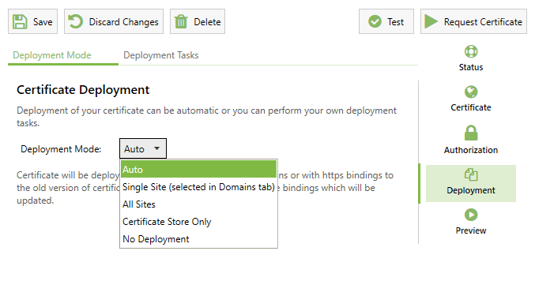

:::note Automatic, not a task
You don't add this as a task. Deployment to IIS happens automatically as part of every certificate request on a Windows server with IIS, using the certificate's *Deployment* settings. It is described here alongside the tasks because it does the same job: putting the renewed certificate where it is needed.
:::

On a Windows server with IIS, each time a certificate is issued or renewed Certify:

1. stores it in the local machine certificate store, then
2. adds or updates the https (and FTP) bindings on IIS sites that should use it.

New certificates use the *Auto* deployment mode, which works for most IIS sites without any changes. You only need the settings below if you want more control, or no automatic deployment at all. Either way, you can still add [Deployment Tasks](../tasks_intro.md) to deploy the certificate elsewhere too.

Check the *Preview* tab before requesting the certificate. It lists the bindings that will be added or updated, and why each one matches.

## Deployment Mode

Choose the *Deployment Mode* under the certificate's *Deployment* settings.

| Mode | Stores the certificate | Updates IIS bindings |
| --- | --- | --- |
| **Auto** (default for new certificates) | Yes | On all **matching** started sites, using the recommended settings below. Auto is usually the right choice for most users. |
| **All Sites** | Yes | On all started sites, using your binding settings. |
| **Single Site** | Yes | On the site selected for the certificate only, using your binding settings. |
| **Certificate Store Only** | Yes | No. Use this when only Deployment Tasks or your own scripts should use the certificate. |
| **No Deployment** | No, the certificate file is only saved to disk | No. |

*Auto* and *All Sites* skip stopped IIS sites. *Single Site* updates the selected site even if it is stopped.

### What Auto does

*Auto* uses fixed settings, so the binding options are hidden while it is selected:

- **Which bindings**: any binding whose hostname matches one of the certificate's domains (including a wildcard domain matching a subdomain), and any binding already using the previous or current version of this certificate. A binding without a hostname is only updated if it already uses this certificate.
- **Adding bindings**: for an http binding that matches and has no https binding with the same hostname, an https binding is added on port 443 with the same hostname, IP set to *All Unassigned* and SNI enabled.
- **Updating bindings**: an existing https binding that matches is switched to the new certificate.

## Binding settings for All Sites and Single Site

These settings appear when you choose *All Sites* or *Single Site*.

### Binding Add/Update

- **Add or Update https bindings as required**: add https bindings for matching http bindings, and update matching https bindings.
- **Update existing https bindings only**: never add bindings, only switch existing https bindings to the new certificate. FTP bindings are not updated in this mode.

### Matching any of

A binding is used when it meets any of the options you select:

- **Existing binding hostname matches certificate domains**: the binding hostname is one of the certificate's domains, or matches a wildcard domain on it. On by default.
- **Binding hostname not specified (IP only or All Unassigned)**: the binding has no hostname. Use this with care: a binding without a hostname can't use SNI, so only one certificate can be used on that IP and port.
- **Existing binding uses old version of same certificate**: the binding currently uses the previous or current version of this certificate. Useful when the hostnames on the binding don't match the certificate, for example a binding added by hand.

### Settings for new bindings

When *Add or Update* is selected, these control how new https bindings are created:

- **Auto create/update IIS bindings (uses SNI)**: on by default. New bindings use port 443, IP *All Unassigned*, and SNI when the binding has a hostname.
- Turn it off to set:
  - **Bind to Specific IP**: only used when the binding has no hostname or SNI is turned off. Otherwise *All Unassigned* is used.
  - **Bind to Specific Port**: the port for new https bindings, instead of 443.
  - **Use SNI (IIS 8+)**: whether new bindings use SNI.

These settings only apply to new bindings. When an existing https binding is updated, it keeps its port, its IP (if it was set to a specific IP) and its SNI setting, and only the certificate changes. The *Preview* tab shows a warning whenever a specific IP or a non-SNI binding is involved.

:::caution
Avoid specific IPs and non-SNI bindings unless you need them. Several certificates on the same IP and port without SNI cause binding conflicts. Use a hostname on each binding, IP set to *All Unassigned*, and SNI. See [Using Certificates in Windows](../../guides/ssl-windows.md).
:::

### FTP sites

FTP site bindings are handled in the same way, with new FTP bindings on port 21. FTP bindings often have no hostname, which *Auto* doesn't match, so for an FTP site choose *Single Site*, select the FTP site, and select *Binding hostname not specified* if its binding has no hostname.

## Certificate storage

- The certificate is stored in the local machine *Personal* (`My`) store, with `[Certify]` in its friendly name.
- Under *Settings*, *Store Certificate Intermediates* (Management Hub) or *Ensure Storage of Certificate Intermediates in Windows CA store* (Certify Certificate Manager) also stores the chain's intermediate certificates in the *Intermediate Certification Authorities* store.
- *Windows Private Key Storage Provider* in the same settings chooses the provider used for the private key. The default is the system default (CNG).
- Older versions of the certificate are removed from the store later, by [certificate cleanup](../../renewals.md#certificate-cleanup).

## Other servers and platforms

- On an instance without IIS, such as Linux or a Windows server without IIS, there are no bindings to update. The certificate is stored, and you deploy it with [Deployment Tasks](../tasks_intro.md).
- To share certificates between several IIS servers, use the [Centralized Certificate Store](./ccs.md) task. If you do, set the Deployment Mode to *Certificate Store Only* or *No Deployment* on the server running Certify, so it doesn't mix local certificate bindings with CCS.
- To bind a certificate to a non-IIS service on an IP and port, see [Update Port Binding](./update-port-binding.md).

## Troubleshooting

- **No bindings are updated**: check the *Preview* tab. The site may be stopped (with *Auto* or *All Sites*), the binding hostnames may not match the certificate's domains, or the Deployment Mode may be *Certificate Store Only* or *No Deployment*.
- **A site without hostnames isn't updated by Auto**: Auto only changes a binding without a hostname if it already uses this certificate. Choose *All Sites* or *Single Site* and select *Binding hostname not specified*.
- **The wrong certificate is shown on another site**: usually a non-SNI or specific-IP binding sharing an IP and port with other sites. See [Using Certificates in Windows](../../guides/ssl-windows.md).
- **Certificate Storage Failed**: the certificate couldn't be written to the store. The error gives the cause. The service account needs permission to write to the local machine store.
