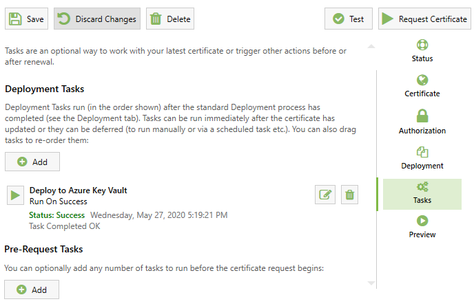

import { DeploymentTaskGroup } from '@site/src/components/DeploymentTaskDirectory';

Once a certificate is issued, you need to put it to use: on a web server, mail server, firewall, load balancer, secrets vault or anywhere else that needs a trusted certificate for your domain. *Deployment Tasks* do this for you each time the certificate is renewed.

By default, Certify stores each certificate in the local machine certificate store and updates matching IIS https bindings on the local server. This [automatic IIS deployment](./tasks/iis.md) needs no task, and is controlled by the certificate's *Deployment Mode*. Add Deployment Tasks when the certificate is needed elsewhere, or when you need extra steps, such as restarting a service after renewal.

## How tasks run

- **Deployment Tasks** (post-request tasks) run after the certificate has been issued and, if enabled, automatically deployed. A certificate can have any number of them, and they run in the order listed. Typical uses are exporting files for other servers (Apache, nginx), copying to remote servers, updating a vault or appliance, and running scripts.
- **Pre-Request Tasks** run before the certificate is requested, for example to open a firewall port for HTTP validation or to call your own webhook. Only some tasks can be used here, such as the [PowerShell](./tasks/powershell.md), [Webhook](./tasks/webhook.md), [Restart a Service](./tasks/restart-service.md) and [Wait](./tasks/wait.md) tasks.

### Task triggers

Each task has a trigger. It can run:

- when the certificate request succeeds,
- when the request fails (useful for notifications), or
- only when you run it manually.

Manual tasks are useful for steps you only want to run at a chosen time, for example restarting a service during a maintenance window. You can run them from the app, or from the [command line](../commandline.md), a script or a scheduled task. The task editor shows the command line arguments to use.

### Previewing and testing

Run a single task with the ▶️ play button in the task list to test it with the current certificate. Many tasks also check their settings and connection when you preview the certificate request, without changing anything, so problems show up before a renewal depends on them.

### Tasks that need Management Hub

Tasks for network appliances, AWS and Kubernetes run only on [Certify Management Hub](../hub/index.md), or on an instance [joined to the Hub](../hub/guides/ccm.md#hub-join). They are marked **Management Hub** below. Tasks marked **Preview** are not in a released version yet.

## Task directory

The built-in tasks, grouped by what they deploy to. Each links to its setup guide.

### Web and application servers

IIS is updated automatically, without a task. For other servers, export the certificate in the format they need, on the local machine, a network share or over SSH. See also [Apache, nginx, and other web servers](../guides/apache-nginx.md).

<DeploymentTaskGroup group="web-servers" />

### Microsoft Windows services

Apply the certificate to services on the Windows server running Certify. Most of these use PowerShell or built-in Windows tools.

<DeploymentTaskGroup group="windows" />

### Secrets vaults

Store the certificate and private key in a vault, so other systems and services can fetch the latest version from there.

<DeploymentTaskGroup group="vaults" />

### Cloud services

<DeploymentTaskGroup group="cloud" />

### Load balancers and application delivery

These tasks keep the certificate's name on the appliance the same on each renewal, so the profiles and virtual servers that use it pick up the renewed certificate.

<DeploymentTaskGroup group="load-balancers" />

### Firewalls and VPN gateways

<DeploymentTaskGroup group="firewalls" />

### Certificate files

Write the certificate files you choose to any local, network or SSH location, for software without its own task. For an introduction to certificate file types see [Certificates](../guides/certificates.md).

<DeploymentTaskGroup group="files" />

### Scripts, webhooks and services

Run your own steps, call other systems, or control services. For more on scripting see [Scripting](../script-hooks.md).

<DeploymentTaskGroup group="automation" />

## Deploying to other servers

To deploy from one Certify instance to other machines, see [Strategies for Remote Deployment](./remote-deployment.md).
